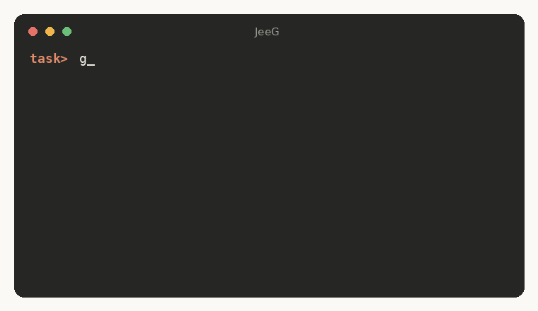
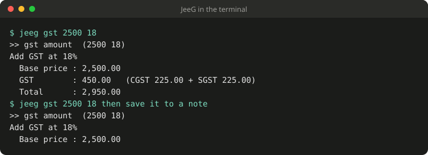
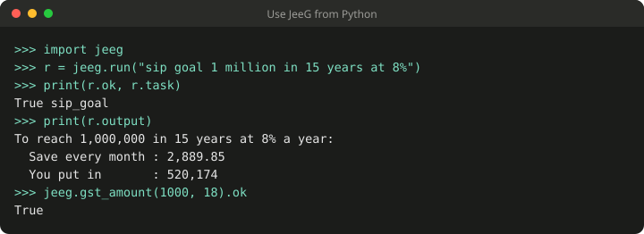

# JeeG - How It Works



You type what you want in plain words ("open youtube", "set timer 10 minutes", "send whatsapp to mom hi").
JeeG finds the matching script in the `scripts` folder and runs it.

- Pure Python 3.9+, nothing to install. Works on Windows, macOS and Linux.
- Light: about 16 MB of memory, about 65 ms per command, nothing running in the background (except reminders and alarms you set yourself).
- 544 ready-made tasks. You can add your own by dropping in a file.

---

## 1. Quick start

0. Easiest: `pipx install jeeg` (or `pip install jeeg`), then `jeeg setup`. (Or use the folder, below.)
1. Install Python 3.9 or newer (python.org). Unzip this folder anywhere.
2. Open a terminal in the folder and run:

       python jeeg.py

3. At the `task>` prompt, type a task and press Enter:

       task> open youtube
       task> weather in mumbai
       task> 25 * 4
       task> exit

One-shot (no prompt): `python jeeg.py "open youtube"`.
Shortcuts: `./jeeg open youtube` (Mac/Linux) or `jeeg.bat open youtube` (Windows) from this folder.
To run it from any folder, run `python install.py` once. That creates the command `jeeg` (`jeeg open youtube`). Use `python install.py --name go` for another name (not `tr`: Mac and Linux already have a program called `tr`) and `python install.py --uninstall` to remove it.
Use quotes when your text has `*` or `?`, for example `python jeeg.py "25 * 4"`.

Type `list` any time to see every task, grouped by category.

The full manual is in `USER_GUIDE.md` (how it works, every feature with examples, adding your own tasks, troubleshooting, and a list of all tasks).

---

## 2. What is inside

    JeeG/
      jeeg.py        the engine (reads what you type, picks the script, runs it)
      scripts/             one small script per task (open_youtube.py, set_timer.py, ...)
        _lib.py _sys.py    helper code shared by the scripts (names starting with _ are not tasks)
        _files.py _dates.py _text.py _money.py _info.py _net.py _time.py _store.py _routine.py _worker.py
      tests/               checks that your phrases pick the right script
      jeeg / jeeg.bat      short launchers
      README.md            this file

Your own data (to-dos, notes, journal, expenses, shopping list, links, snippets, habits, birthdays, routines, reminders, history) is stored in a folder named `.jeeg` in your home folder. Files are written safely (a crash cannot half-write them). Set `JEEG_HOME` to keep that data somewhere else. If you used an earlier version, your old `.taskrunner` folder is still found and used automatically (`TASKRUNNER_HOME` also still works).

---

## 3. How a command is handled, step by step

When you type `search youtube lofi beats`:

**Step 1 - Read the scripts folder (fast).**
The engine looks at every script in `scripts/`. Each script starts with a few comment lines that describe it:

    # keywords: video, videos, watch, search
    # desc: Open YouTube or search it
    # category: entertainment

The engine remembers these in a small cache file, so the next start only re-reads scripts that changed.

**Step 2 - Clean up what you typed.**
Filler words ("please", "the", "can you", "how", "what") are ignored. Plurals are simplified ("downloads" = "download").

**Step 3 - Score every script.**
Each script earns points for matching your words:

| Match | Points |
|---|---|
| A word in the script's file name (`open_youtube`: "youtube") | highest |
| A word in its `keywords:` line | slightly lower |
| A close spelling (a typo like "brwoser", or swapped letters like "taems") | slightly lower again |
| Very common words ("open", "folder", "search") | very low, so they never decide alone |

The best score wins. This is why "open youtube" opens YouTube and not Gmail: the word "open" is shared by more than 110 scripts and counts for little, while "youtube" is unique.

**Step 4 - Decide.**
- One clear winner: it runs.
- Two scripts fit equally well: you get a numbered menu and choose. It never guesses on a tie.
- Nothing fits: it says so. (Special cases: `open <app name>` tries to launch that installed app, `open github.com` opens the website, and plain maths like `25 * 4` goes to the calculator.)

**Step 5 - Pass your extra words to the script.**
Words that were not used to find the script become its arguments:

    search youtube lofi beats   ->  script open_youtube.py gets:  lofi beats
    weather in mumbai           ->  script check_weather.py gets: mumbai

Put text in double quotes to keep it exactly as typed: `search "to be or not to be"`.

**Step 6 - Safety check, then run.**
Risky tasks (shutdown, restart, kill a program, delete, git push, pip install...) ask `Run 'shutdown pc'? [y/N]` first.
If JeeG is started by another program (no keyboard), it refuses these unless you add `--yes`.

**Step 7 - Report.** You see `ok in 0.05s` or `failed (exit 1)` and the script's own message.
The task is saved to history so you can type `again` to repeat it.

---

## 3b. Several tasks in one line

    open gmail and open calendar
    open youtube, then set timer 20 minutes

JeeG splits on "and", "then", ";" and "&" (not commas, so `random choice pizza, burger or pasta` and `1,200.50` stay whole). It only runs the parts as separate tasks if every part clearly matches a *different* script and none of them is a free-text task (messages, timers, notes). Otherwise your line is treated as one task, so `search tom and jerry` is still one search.

---

## 4. Everything you can type

| Command | What it does |
|---|---|
| `list` / `list web` | Show all tasks / only a category |
| `again` | Repeat the last task |
| `history` | Recent tasks |
| `reindex` | Rebuild the script cache |
| `selftest` | Check every script (has a description, keywords, valid code, and is found by its own name) |
| `alias add wa = send whatsapp to` | Your own short word for any task (then `wa mom hi`). Also `alias list`, `alias remove wa` |
| `explain <words>` | Show which tasks match what you typed, their scores, and which one would run |
| `misses` | Phrases that matched nothing, so you can teach them with an alias |
| `stats` | Which tasks you use most, how fast, and how often they fail |
| `doctor` | Check Python, the data folder, scripts, optional tools and internet |
| `exit` | Quit |

Options (put before your words):

| Option | Meaning |
|---|---|
| `--dry-run` | Show what would run, run nothing |
| `-y` / `--yes` | Do not ask for confirmation |
| `--timeout 30` | Stop a script after 30 seconds |
| `--dir PATH` | Also read scripts from another folder (can repeat; also `TASK_SCRIPTS_DIR`) |

Exit codes: 0 ok, 1 error or no match, 2 ambiguous, 3 declined.

---

## 4b. Teaching it

- **Aliases.** `alias add wa = send whatsapp to` saves a short word. It only accepts an alias that points at a real task (so a typo cannot create a dead alias), and it refuses names of built-in commands. Aliases are stored in `aliases.json` in your data folder; you can also edit that file.
- **Did you mean.** If nothing matches but something is close ("opne youtub"), it asks `Did you mean 'open youtube'? [y/N]`. Answer `y` and it runs that task and remembers your wording as an alias (the message tells you how to undo it). Without a keyboard it only prints the suggestion.
- **Why did it pick that?** `explain open youtube` prints the top matches with their scores. A line marked `tied` means you would get a menu.
- **Logs stay on your computer.** `history.jsonl` (what you typed; skipped for private tasks), `log.jsonl` (task name, result, seconds), `misses.log` (phrases that failed) are all in `.jeeg`. Delete them any time.

## 5. Examples by category

| Area | Examples |
|---|---|
| Web and services | `open youtube`, `search cats`, `images of golden retriever`, `weather in mumbai`, `directions to taj mahal`, `translate good morning`, `open github.com`, `compose email`, `add event dentist` |
| Music and messages | `play shape of you`, `play blinding lights on spotify`, `play` (pause/resume), `add contact mom 9876543210`, `send whatsapp to mom see you at 5` |
| Apps | `open chrome`, `open vscode`, `open task manager`, `open settings`, `open vlc`, `open app <any installed app>` |
| Folders and files | `open downloads`, `find file invoice`, `folder size downloads`, `large files`, `find duplicates`, `organize downloads preview`, `backup folder documents`, `zip folder x`, `unzip file x.zip` |
| System | `system info`, `memory usage`, `cpu usage`, `battery status`, `disk space`, `running processes`, `kill process notepad` |
| Network | `check internet`, `show ip`, `wifi info`, `ping host google.com`, `dns lookup x.com`, `port check host 443`, `check website github.com` |
| Power and hardware | `lock screen`, `shutdown pc`, `restart pc`, `cancel shutdown`, `schedule shutdown 45 minutes`, `volume up`, `set volume 40`, `mute`, `next song`, `set brightness 60`, `take screenshot`, `toggle dark mode` |
| Utilities | `25 * 4`, `15% of 200`, `convert 5 km to miles`, `generate password 20`, `roll 2d6`, `set timer 10 minutes tea`, `random choice a, b, c`, `hash text hello` |
| Productivity | `add todo buy milk`, `todo list`, `todo done 1`, `add note call dentist`, `show notes`, `days until 25 dec 2026`, `age calculator 14 aug 2001` |
| Developer | `git status`, `git commit fix bug`, `git stash`, `git stash pop`, `git checkout new feature-x`, `undo last commit`, `serve folder`, `create venv`, `pip install requests`, `kill port 3000`, `docker ps`, `check versions`, `http get https://example.com`, `new project demo flask`, `lines of code myproject`, `json to csv data.json`, `csv preview sales.csv`, `create gitignore python`, `env variables`, `show path` |

### More tasks (added in version 2.1)

| Area | Examples |
|---|---|
| Routines | `start work day`, `end work day`, `study mode`, `meeting mode`, `night mode`, `run routine <name>`, `list routines`, `edit routines` (routines live in an editable `routines.json`) |
| Reminders and time | `remind me in 20 minutes to call mom`, `set alarm 6:30 am`, `show reminders`, `stop reminders`, `water reminder`, `eye break`, `stretch reminder`, `pomodoro`, `daily briefing` (reminders run in a small background process and survive closing the terminal; a time like `5:30` without am/pm is read as 24-hour) |
| Personal records | `journal add had a great day`, `journal show 7`, `add expense 250 lunch`, `show expenses`, `expense total`, `undo expense`, `shopping add milk`, `shopping list`, `save link <name> <url>`, `open link <name>`, `habit done gym`, `habit streak gym`, `add birthday mom 12 mar`, `upcoming birthdays`, `save snippet`, `paste snippet` |
| Money (Indian grouping, lakh/crore) | `emi loan 25 lakh 8.5% 20 years`, `sip growth 5000 12% 15 years`, `compound interest ...`, `gst amount 1000 18%`, `split bill 2450 among 4`, `percentage change 80 to 100`, `discount price 2999 30%`, `currency convert 100 usd to inr`, `crypto price bitcoin` |
| Live information (needs internet) | `weather in pune`, `wiki summary python`, `define serendipity`, `news headlines`, `pincode 560001`, `cricket score`, `stock price tcs`, `lyrics <song>`, `recipe <dish>`, `movie info <title>`, `restaurants near me`, `pharmacy near me`, `flight status 6E 204`, `train status 12951`, `pnr status <10 digits>` |
| Dates and time | `time in london and tokyo`, `what day is 15 aug 2027`, `add 45 days to 1 jan 2027`, `10 days ago`, `days between 1 jan 2027 and 25 dec 2027`, `week number`, `unix timestamp 1700000000` |
| Files and media | `bulk rename downloads replace img with photo` (preview first; add `apply` to do it), `delete empty folders <folder> preview`, `delete old downloads 90 days` (moves them to a holding folder, deletes nothing), `find text invoice in documents`, `file types in downloads`, `open last download`, `copy path of report.pdf`, `folder tree documents depth 3`, `move file a.txt to documents`, `copy file a.txt to desktop`, `resize image photo.jpg to 800`, `convert image a.png to jpg`, `images to pdf <folder>`, `merge pdf a.pdf b.pdf`, `split pdf report.pdf pages 2-4`, `compress video movie.mp4`, `extract audio movie.mp4` |
| System extras | `keep awake 2 hours`, `startup programs`, `installed programs chrome`, `check updates`, `screen resolution`, `usb devices`, `gpu info`, `cpu temperature`, `listening ports`, `restart explorer`, `turn off screen`, `live network speed` |
| Security | `password strength "..."`, `breach check "..."` (only the first 5 characters of a hash are sent; what you type is never saved to history), `compare files a.txt b.txt`, `shred file secret.txt` |
| Text tools | `uppercase hello`, `lowercase`, `title case`, `reverse text`, `sort lines pear, apple`, `remove duplicates a, b, a`, `word frequency notes.txt`, `number to words 1234567` (Indian and international), `roman numeral 2026`, `binary 1010`, `hex ff`, `lorem ipsum 3 paragraphs`, `qr code https://example.com` (text tools copy their result to the clipboard) |
| Fun and learning | `guess the number`, `rock paper scissors`, `typing test`, `multiplication table 7 up to 20`, `quiz me` (from a `question \| answer` notes file) |

Notes:
- Tasks that change or remove things (`delete empty folders`, `delete old downloads`, `shred file`, `undo last commit`, `check updates`, `restart explorer`) ask first. Add the word `preview` to the delete tasks to only list what would happen.
- `undo last commit` keeps your changes and refuses if the commit is already pushed.
- Some tasks need an optional tool: `pip install pillow pypdf qrcode[pil]` for pictures, PDFs and QR codes; `ffmpeg` for video and audio; `psutil` for extra detail. The task tells you exactly what is missing.
- Tasks that need the internet say so plainly when you are offline; they never hang.

Notes on three popular tasks:
- **Play a song** opens a search (YouTube Music by default). A browser cannot press play for you, so click the first result.
- **WhatsApp** opens a chat with your message already typed; you press send. WhatsApp does not allow silent sending. Ten-digit numbers are assumed to be India (+91).
- **Opening websites** uses your normal browser, so you stay signed in. JeeG never reads your passwords or data.

---

### New in version 2.3

| Area | Examples |
|---|---|
| Data safety | `export data`, `import data backup.zip`, `backup status` (a gentle reminder appears if you have not backed up for a while), `export records expenses` |
| Summaries | `weekly summary`, `monthly summary` |
| Daily life | `water log 500 ml`, `sleep log 7 hours`, `bmi 70 kg 175 cm`, `tip 1200 10%`, `unit price 500g 45 vs 1kg 80`, `fuel cost 250 km 18 kmpl 105`, `add bill electricity 15 1200`, `upcoming bills`, `add class maths mon 9:00`, `todays classes` |
| Time and sky | `meeting time 9 am india in london`, `sunrise delhi`, `moon phase`, `public holidays india 2026` |
| Files and developer | `old large files`, `rename photos by date <folder>`, `compare folders a b`, `zip with password <folder>`, `file hash <file>`, `json to yaml`, `run tests`, `who uses port 3000`, `regex test`, `git contributors` |
| Engine | `pack off <category>` / `pack on <category>`, `tips`, routines that take words (`run routine morning Asha`), closest-task suggestions, failing-task flags in `stats` |

Optional extras for a few of these: `pip install pyzipper pyyaml`.

### New in version 2.4

| Area | Examples |
|---|---|
| Undo | `undo` (puts back your last file move, rename or Downloads tidy; remembers 20; never overwrites) |
| Contacts | `add email mom mom@example.com`, `find contact mom`, `remove contact mom`, `email mom about dinner` |
| Budgets and goals | `set budget food 5000`, `budget report` (and `add expense` warns you near or over a limit), `add countdown exam 12 dec 2026`, `show countdowns` |
| Your data | `search my data dentist` |
| Files and data | `large folders downloads`, `csv summary data.csv`, `text diff a.txt b.txt`, `json minify`, `url encode`, `url decode` |
| Engine | `plugins`: extra task scripts placed in the `plugins` folder of your data folder are found automatically |

### New in version 2.5

| Area | Examples |
|---|---|
| Install and update | `pip install jeeg`, `setup` (wizard), `update` / `update now` |
| Plugins | `plugin new tea_timer`, `plugin install file.py`, `plugin export`, `plugin remove`, `plugin list` |
| Easier to use | typo repair (`opn gmial` -> `open gmail`), `completion bash\|zsh\|powershell`, `web` (a private page on your own computer) |
| New tasks | `invoice Ravi Traders: 3 pens at 10 gst 18`, `rd 5000 6.5 2 years`, `save clipboard`, `clipboard history` |

### New in version 2.6

| Area | Examples |
|---|---|
| Files | `pdf to text report.pdf`, `read text from scan.png`, `compress pictures downloads`, `rename files in trip as holiday_{n}.{ext} apply` |
| Tracking | `life report` (visual page), `study log maths 45 min`, `add medicine metformin at 8am`, `what is due`, `journal prompt` |
| Plugin library | `plugin search loan`, `plugin get loan_prepay` (fingerprint-checked) |
| Sharing | `routines export`, `routines import file`, `alias export`, `alias import file` |
| Help yourself | `learn` (tour), `doctor fix`, short forms like `pwd` and `mail` |
| Privacy | `privacy` lists the few tasks that can go online; see `PRIVACY.md` and `SECURITY.md` |

### New in version 2.7

| Area | Examples |
|---|---|
| For other programs | `jeeg --json gst 2500 18`, `jeeg --output result.txt gst 2500 18` |
| First run | the tour is offered once; `misses export` shares what JeeG did not understand |
| Money | `lend 500 to ravi`, `borrow 300 from asha`, `ledger`, `settle ravi` |
| Dates | `add warranty laptop 12 mar 2027`, `add vehicle due insurance bike 15 dec 2026`, `add vaccine asha polio 12 nov 2026`, `what is due` |
| Personal | `weight 72.5 kg`, `add book Atomic Habits`, `books` |

## 6. Adding your own task

1. Create a file in `scripts/` named after the task, for example `open_notes_app.py`. The file name is what people will say ("open notes app"), so use words, joined by underscores.
2. Put a header at the top (first 15 lines) and then your code:

       # keywords: notes, notebook, jot
       # desc: Open my notes app
       # category: apps
       from _lib import launch
       launch(win=[("start", "onenote")], mac=[("open", "-a", "Notes")], linux=[("gnome-notes",)], name="Notes")

3. Type `selftest`. It confirms the new script is found by its own name.

Any language works: `.py`, `.bat`, `.cmd`, `.ps1`, `.sh`, `.js`.
You can also keep your personal scripts in another folder and use `--dir`, so updates never touch them.

Header options:

| Line | Meaning |
|---|---|
| `# keywords:` | Extra words that should find this script |
| `# desc:` | One-line description shown by `list` |
| `# category:` | Group name in `list` |
| `# usage:` | Marks that the task accepts words after its name (like `search <words>`) |
| `# confirm: yes` | Ask before running |
| `# priority: 1` | Wins ties against equally good matches |
| `# rawargs: yes` | Pass your words through untouched (used by timers, calculator, messages) |
| `# rawargs: full` | Pass the whole sentence, including the task words and quotes where you typed them (used by date maths and `find text`) |
| `# patterns: regex ;; regex` | Phrases that identify this task even when single words are ambiguous (for example `\d+ days ago`) |
| `# private: yes` | Never write what you typed to history (used by the password tasks) |

Helpers you can use inside Python scripts (from `_lib.py`): `args_text()` (the words after the task), `open_url(url)`, `launch(...)` (open an app on any OS), `fail("message")`, `call([...])` (run a program), `data_dir()` (a place to save data).

---

## Share a plugin

A plugin is one `.py` file. Make a starter with `jeeg plugin new my_task`, edit it, and try it. To share it:

1. Keep it to the standard library, one file, under 200 KB, and make it say honestly what it does in `# desc:`.
2. Put it in `library/`, run `python tools/make_library_index.py`, and open a pull request (or use the "Share a plugin" issue template and paste the file).
3. Others can then add it with `jeeg plugin get my_task`. JeeG checks the fingerprint and shows what the plugin says it does before installing.


## 7. Safety summary

- Dangerous tasks always ask first (see step 6).
- Nothing is deleted without confirmation; temp cleaning only touches files older than 24 hours.
- Zip extraction refuses archives that try to write outside their folder.
- Host names, ports and package names are checked before being passed to other programs.
- Critical system processes cannot be killed with `kill process`.
- No task sends your files or personal data anywhere. Web tasks only open a page in your browser.

## What is new in 2.20

- **Link programs and more services:** programs with no web API (`docker`, `git`, `adb`, `kubectl`) as command apps, ready-made presets (GitLab, Notion, Linear, Todoist, Home Assistant, Jira), logins in the system keychain, device login without pasting a token.
- **Event rules:** `rule add ... when github issues changes then ...` acts on new items.
- **More control over an AI:** allow or deny each app, "always allow" for one action, preview-only mode. `real test compare` shows what changed after an update. See APPS.md.

## What is new in 2.19

- **Test JeeG on your own computer, with an AI if you like.** `real test run all` runs 43 harmless checks; `real test report` makes a private report; `real test ai` gives you the text to paste into Claude.ai so it runs the test through JeeG and explains any failure. See REAL_WORLD_TEST.md.

## What is new in 2.18

- **Link JeeG to your apps** so an AI (or you) can reach what lives on your own devices: `app login github`, `app read github issues`, `app do telegram send chat=123 text="Done"`. GitHub, Telegram, Discord, Slack and WhatsApp are built in, and `app add` links any web API. Reads are separate from writes, writes always ask, and an AI cannot link or change anything. See APPS.md.

## What is new in 2.17

- **Install and set up programs by name:** `install vlc`, `install dev bundle`, `uninstall vlc`, `update all apps`, `configure git name Ravi email r@x.com`, `is git installed`, `set env variable ...`, `add <folder> to path`. They ask first, and `preview` shows the command only.
- **Network:** `network doctor`, `who is on my wifi`, `watch page|price|site|ssl|release`, `read my feeds` (RSS), `save page <url>`, `send file.pdf to my phone` (link and QR code, one download).
- **Machines and shops:** `check all computers`, sensor readings with alerts and a chart, `printer status`, `print <file>`, `stock add ...` / `low stock`, `query database shop.db select ...` (read only).

## What is new in 2.16

- **Connectors:** Telegram bot, incoming hooks, webhooks, Wake-on-LAN, ssh to other computers, smart plugs, MQTT, Android (adb), serial, JeeG-to-JeeG, JeeG as an MCP client, mail, GitHub, calendar feeds, an OpenAPI file and a JavaScript client. Everything is off until you set it up. See `CONNECTORS.md`.

## What is new in 2.15

- **`selfcheck`** (does JeeG work on this computer?), AI mode extras (`allow always`, `limit`, `notify`, `ai log`, `install mcp claude-desktop`), new tasks `payment reminder`, `action items`, `screen text`, `preview` for risky file tasks, a fuzz test, and winget templates. See `MANUAL_TEST.md`.

## What is new in 2.14

- **Approve from your phone:** `connect ai phone` shows the AI's y/n questions on your phone with Allow and Deny buttons (own secret link + PIN, shown only in the terminal).

## What is new in 2.13

- **AI mode:** `connect ai read` (look-only), `allow <category>`, `keep` (same link every time) and a private session log. New tasks: `health check`, `contact sheet`, `search clipboard history`. Light/dark button on the web page.

## What is new in 2.12

- **AI mode:** `connect ai` makes a temporary https link (through `cloudflared` or `ngrok`, which you install yourself) that you paste into Claude.ai (Settings > Connectors > Add custom connector) or any AI that can open links, so it can use JeeG on your computer. Three modes: `safe`, `ask` (default: you type y for anything beyond the safe list) and `god`. Time-limited, secret link, every call printed. See REMOTE_AI.md.

## What is new in 2.11

- **Phone page god mode:** `web lan god` lets a phone run any task (apps, files, chains, confirmation buttons) with a secret link, a 6-digit PIN, 5-try lockout, a time limit and a terminal log. `web lan` stays the safe default.

## What is new in 2.10

- **Variables and `ans`:** `set var rate = 18`, then `gst 1000 $rate`; `calculate ans * 2`.
- **Search inside your files, offline:** `index folder Documents`, then `search index invoice march` (SQLite full-text search; secrets are never indexed).
- **Spending analytics:** `spending trends`, `spending forecast`, `spending anomalies`.
- **`batch file.txt`** runs a list of phrases; **spelled-out numbers** work (`five lakh`, `two thousand`).

## What is new in 2.9

- **10 new tasks:** `csv to json`, `chart csv`, `readability`, `replace in files`, `strip exif`, `profit margin`, `compare loans`, `freelance rate`, `toml to json`, `watch folder`.
- **Smarter:** it remembers which task you picked when two fit; routines can use `{today}`, `{month}`, `{year}`...
- **Phone page:** `web lan` (safe mode: secret link, same Wi-Fi, about 70 safe tasks) and `web lan god` (every task, with a PIN, a time limit and confirmation buttons).
- **No Python needed:** download `jeeg-windows-x64.exe`, `jeeg-macos` or `jeeg-linux-x64` from a release; `update now` keeps it current (SHA-256 checked).
- **Right-click "Send to JeeG"**, a **browser extension**, Raycast and Alfred launchers (`integrations/`).
- `report` makes a bug-report file; `share plugin|routines|aliases` makes one shareable file.
- Publishing guide for PyPI, Homebrew, Scoop, winget and more: `DISTRIBUTION.md`.

## What is new in 2.8

- **Chain tasks:** `gst 2500 18 then save it to a note` (also `then copy it`, `then speak it`). The first task's answer is passed on; tasks that ask for confirmation are never chained.
- **Pipe text in:** `type notes.txt | jeeg word count`, `cat list.txt | jeeg sort lines`, `type data.json | jeeg format json` (Windows `type`, Mac/Linux `cat`). Up to 1 MB; words you type win over piped text.
- **Run things by themselves:** `autorun add "start work day" at 9:00 weekdays` sets up Task Scheduler (Windows) or cron (Mac/Linux). `autorun list`, `autorun remove 1`.
- **Your habits:** `my habits` shows what you use most, what often fails, and phrases worth a shortcut. Local only.
- **Better typo fixing:** `shutdwn pc` offers `shutdown pc`, trying every close spelling of each word.
- **Plugins:** `plugin update` (and `plugin outdated`) refresh library plugins after checking their fingerprints; five new library plugins.
- **22 new tasks:** salary breakup, interest tax, severance, credit card dues, savings goal (`sip goal`), PDF rotate / compress / watermark / to pictures (optional `pip install pypdf pypdfium2 Pillow`), GPA planner, citations, medicine stock, BP and sugar log, fasting timer, gas cylinder, milk and maid log, flatmate split, regex explainer, colour converter, `.env` checker, checksum verifier, HTTP header check.
- **Python, other languages, apps:** `import jeeg`, `jeeg --serve-api`, `jeeg --stdio`, `jeeg --mcp` (see PYTHON_GUIDE.md and INTEGRATIONS.md). A starter VS Code extension is in `integrations/vscode/`.
- **Find any task:** the searchable list is `docs/tasks.html` (on the project page under Tasks).




## Use JeeG from your own Python programs (full guide: PYTHON_GUIDE.md)

JeeG is also a library. After `pip install jeeg`:

```python
import jeeg

r = jeeg.run("gst 2500 18")        # say it in words, like at the prompt
print(r.output)                     # what the task printed
if r.ok: ...                        # True when the exit code is 0

jeeg.gst_amount(1000, 18).output    # or call a task by name, with arguments
jeeg.find("open youtube")           # which task would run (runs nothing)
jeeg.tasks(category="money")        # list what exists; jeeg.categories(), jeeg.task_info("gst_amount")

j = jeeg.JeeG(home="my-data", timeout=30)   # your own data folder and settings
j("add expense 250 food lunch")
```

- A `Result` has `.ok`, `.exit`, `.output`, `.lines`, `.task`, `.runs`, `.needs_confirmation`, `.ambiguous`, `.candidates`, `.json()`. Pass `check=True` to raise `JeeGError` on failure.
- Calls never prompt. Tasks that ask for confirmation return exit code 3 unless you pass `yes=True`.
- Library calls are not added to your command history (`history=True` to include them).
- `run_task("name", args...)` skips word matching, so it is the predictable choice inside programs.
- `jeeg.run_many(["gst 100 5", "disk space"])` runs several phrases; `await jeeg.arun("...")` is the asyncio version.
- `jeeg.on("after", fn)` hooks and `jeeg.watch("check internet", every=300, callback=print)` to repeat a phrase. `jeeg --list-json` prints every task as JSON for other languages.
- Terminal-only commands (`web`, `setup`, `update`, `plugin`, ...) are refused from Python.
- Thread-safe: calls run one at a time. Standard library only, local only. Examples are in `examples/`.

## Use JeeG from other programs and apps

- Any language: `jeeg --json <phrase>`, `jeeg --stdio` (JSON lines), `jeeg --serve-api` (local HTTP with a token).
- Apps that support MCP (for example Claude Desktop): `jeeg --mcp`.
- Everything stays on your computer; the API listens on 127.0.0.1 only and refuses web pages. Tasks that ask for confirmation are refused unless you start with `--allow-confirm`.
- Limit what a program may do: `--only money,text` or `--except files,system`; `--log` keeps a private call log.
- Full guide: INTEGRATIONS.md. Examples for Node.js, curl and Python: `examples/other_languages/`.

Security notes: only safe link types are opened, archives cannot write outside their folder, backups are validated before import, your data folder is private to you on Mac/Linux, over-long or control-character input is refused, and unexpected errors show one plain line (`JEEG_DEBUG=1` for details). Plugins and `--dir` folders run with your permissions, so only use ones you trust.

## 8. Troubleshooting

| Problem | Fix |
|---|---|
| `python` not found | Install Python from python.org (tick "Add to PATH"), or use `py jeeg.py` on Windows |
| "No matching task" | Type `list`. Try the words from the task name, or add keywords to the script |
| A menu appears | Two tasks fit equally; pick a number, or be more specific ("open youtube music") |
| "needs confirmation; re-run with --yes" | You are running without a keyboard; add `--yes` if you really want it |
| A task says a tool is missing | Some tasks use optional tools (Linux: `playerctl`, `brightnessctl`, `xclip`, `espeak-ng`). The message names what to install |
| Changed a script but nothing changed | Type `reindex` |
| Check everything is healthy | `selftest`, then `python tests/test_routing.py` |

Optional extras: `pip install pillow psutil pypdf qrcode[pil]` (screenshots, process details, picture/PDF/QR tasks). `ffmpeg` is needed for the video and audio tasks.

## 9. Checking it yourself

    python jeeg.py selftest        every script: header, valid code, found by its own name
    python tests/test_routing.py         about 300 phrases and multi-task lines must pick the right script
    python tests/test_parsers.py         the online tasks against sample API replies (no internet needed)
    python tests/test_engine.py          aliases, explain, did-you-mean, logs, installer, undo, budgets, plugins
    python tests/test_security.py        unsafe links, archives, backups, long or odd input, private data folder
    python tests/test_cmds.py            update, plugins, setup, completion, the local web page, new tasks
    python tests/test_v26.py             plugin library, sharing, tracking, file tasks, doctor fix, tour
    python tests/test_privacy.py         which files can use the network, documented addresses
    python tests/test_v27.py             --json/--output, first-run tour, new tasks, speed guard

The folder includes `.github/workflows/test.yml`. If you put this project on GitHub, it runs all eight test files, and builds and installs the pip package, on Windows, macOS and Linux with Python 3.9 and 3.12 on every change, which is the easiest way to find problems on systems you do not have at hand.

## 10. What was and was not tested

- Routing, maths (EMI, SIP, GST and so on), dates, file, text, PDF, picture, git and personal-record tasks are tested automatically on Linux, including typo and polite-wording variants of every task name.
- Online tasks (weather, Wikipedia, news, currency, crypto, dictionary, pincode, breach check, public holidays, exchange rates, gold price) are tested against sample replies shaped like the real services, not the live services. If a provider changes its format, that one task will say it could not read the answer.
- Not built, on purpose: a pop-up launcher window (needs Tk, which I could not run here) and recurring scheduled tasks through cron or Windows Task Scheduler (could not be tested here). Both are best added once they can be tried on your own computer.
- Windows- and macOS-specific parts (volume keys, startup list, installed programs, screen off, restart explorer, and similar) were written carefully but have not been run on real Windows or macOS machines here. Report any that misbehave and they are quick to fix.
